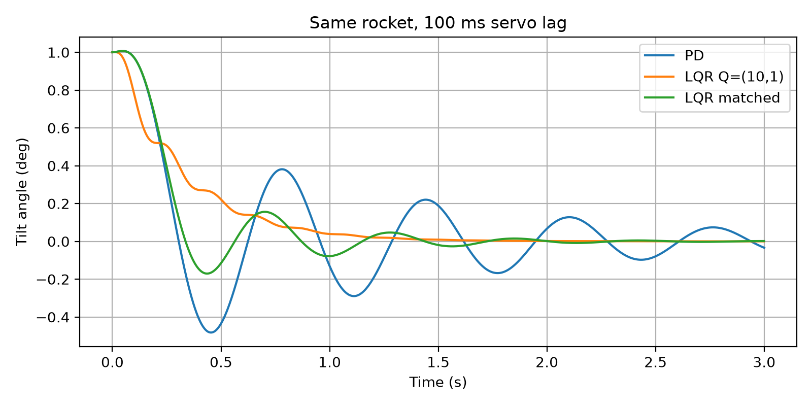
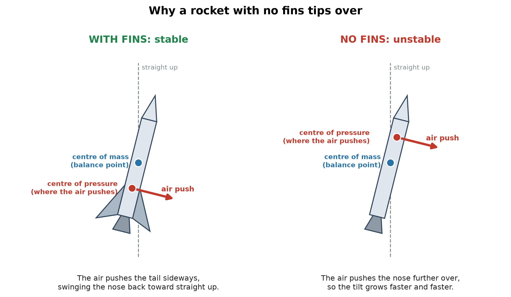
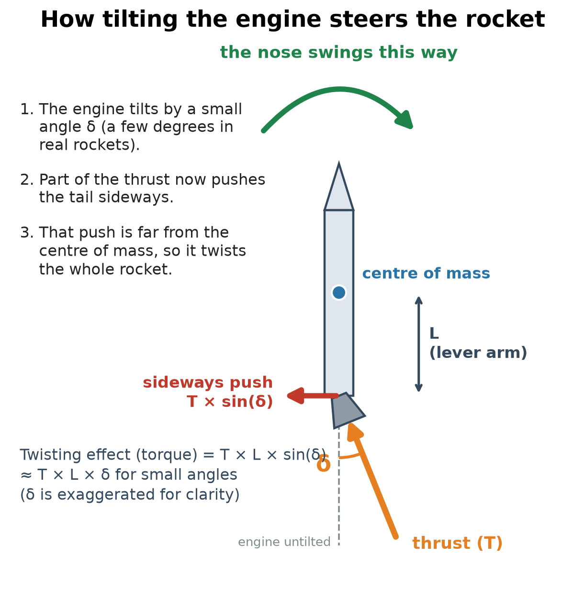
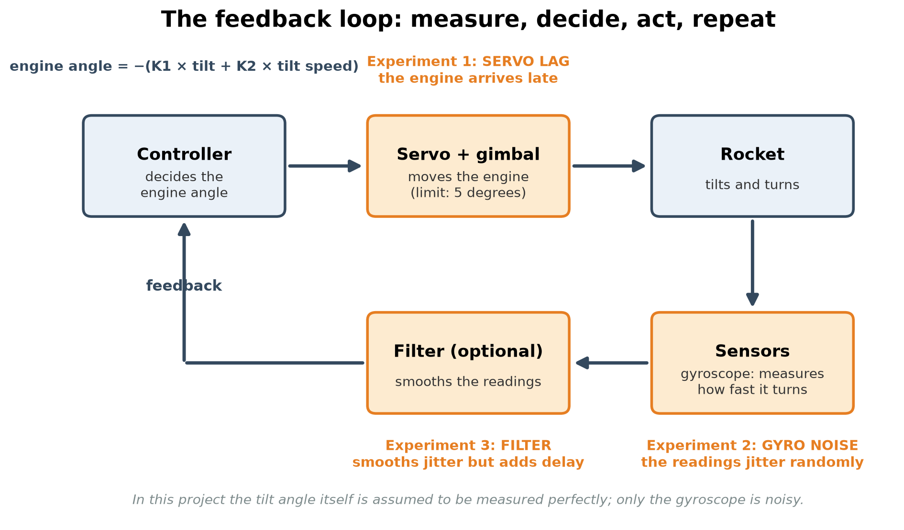
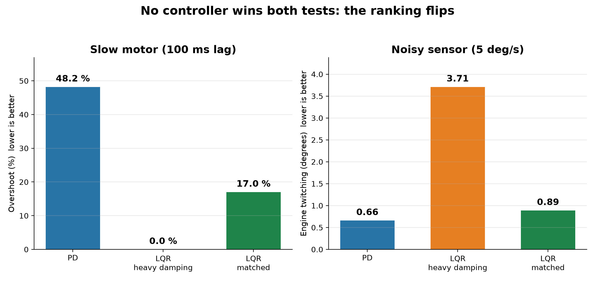

# Gimbaled rocket attitude control: PD vs LQR in Python

A first-year aerospace engineering project (Nov 2026). It simulates a small finless rocket that keeps itself upright by tilting its engine, designs two controllers (PD and LQR), and tests how each one copes with imperfect hardware: a slow servo, a noisy gyroscope, and a filter on the gyro signal.

*Same rocket, same 1 degree starting tilt, 100 ms servo lag. Blue: PD. Orange: LQR with heavy damping. Green: LQR tuned to use the same engine effort as PD.*

## The short version

No controller won every test. The one that handled a slow servo best handled sensor noise worst, and the reverse. Adding a noise filter helped only when nothing else in the loop was already adding lag.

## What I found

| Test | PD | LQR, heavy damping | LQR, matched to PD |
|---|---|---|---|
| Ideal conditions (overshoot, settling time) | 4.0 %, 0.68 s | 0.0 %, 1.25 s | 0.0 %, 0.63 s |
| 100 ms servo lag | 48 % overshoot, not settled after 3 s | 0.0 %, 1.21 s | 17 %, 1.63 s |
| 150 ms servo lag | 186 % overshoot, growing | 0.3 %, 1.36 s | 42 %, not settled |
| Engine jitter, 5 deg/s gyro noise | 0.66 deg | 3.71 deg | 0.89 deg |

1. **Matched on engine effort, PD and LQR performed almost the same** in ideal conditions (0.68 s against 0.63 s). My first LQR looked slow only because of the weights I chose.
2. **Speed and robustness trade off.** With servo lag, the fastest-tuned controller (PD) went wrong first, and the heavily damped LQR barely noticed.
3. **Noise reverses the ranking.** The heavily damped LQR uses about 8 times the gain on tilt speed, so it amplifies gyro noise about 8 times more, and its engine command repeatedly hits the 5 degree limit.
4. **A gyro filter is not free.** With a perfect servo, a 20 ms filter cut PD jitter from 0.66 to 0.16 degrees. With a 30 ms servo already in the loop, the same filter added almost nothing for PD, and pushed the heavy LQR into a sustained oscillation (tilt within about 0.2 degrees, but the engine swinging almost 4 degrees).

## The model

A two-state, small-angle model of pitch motion:

    tilt acceleration = mu_c * engine angle + mu_a * tilt angle

- `mu_c = T * L / I` is how strongly the engine twists the rocket (thrust 30 N, lever arm 0.4 m, moment of inertia 0.125 kg m^2, giving 96 per s^2).
- `mu_a = 20 per s^2` is the destabilising push from the air on a finless body (centre of pressure ahead of the centre of mass).
- The engine can tilt at most 5 degrees. Every run starts with a 1 degree tilt.

The parameters are illustrative, not a real vehicle.

## The controllers

- **PD:** engine angle = -(Kp * tilt + Kd * tilt speed), with Kp = 1.0 and Kd = 0.13 (damping ratio about 0.7).
- **LQR:** gains from the algebraic Riccati equation, with cost weights Q on tilt and tilt speed and R on engine use. "Heavy damping" uses Q = diag(10, 1). "Matched" uses Q = diag(0.58, 0.01), chosen so its peak engine angle is the same 1.0 degree as PD, which makes the comparison fair.

## Imperfections tested

- **Servo lag:** the engine chases the commanded angle with a first-order time constant of 0 to 150 ms.
- **Gyro noise:** Gaussian noise added to the measured tilt speed (0 to 10 deg/s), averaged over 10 runs with fixed random seeds.
- **Gyro filter:** a first-order low-pass filter on the gyro reading (10 and 20 ms).

## Limitations

- Two states only: no lateral motion, no wind, no changing mass or thrust curve.
- The aerodynamic term is held constant, though on a real rocket it grows with speed.
- Only the gyro is noisy; the tilt angle is assumed to be measured perfectly.
- The controller is PD, not full PID, because this model has no steady drift for an integral term to correct.
- Simulation only. Nothing here has been validated on hardware.

## Run it

Install Python 3.11 or newer, then:

    python -m pip install numpy scipy matplotlib
    python compare.py

| File | What it does |
|---|---|
| `open_loop.py` | The rocket with no control, tipping over |
| `closed_loop.py` | PD controller with performance metrics |
| `lqr.py` | LQR controller with adjustable weights |
| `compare.py` | PD and both LQR versions on one graph |
| `servo_lag.py` | Servo lag experiment |
| `gyro_noise.py` | Gyro noise experiment |
| `gyro_filter.py` | Gyro filter experiment (takes about 30 seconds) |
| `notes.md` | Working notes and full result tables |
| wind_pid.py | Wind and PID experiment |

## Next steps

Add wind gusts and centre-of-mass shifts, add an integral term for a full PID, use a nonlinear model without the small-angle approximation, and validate on a 3D-printed gimbal.

## References

- Comparison of LQR, LQG and PID control for a finless rocket, *Machines* 11(3), 394 (2023): https://mdpi.com/2075-1702/11/3/394
- Sutton and Biblarz, *Rocket Propulsion Elements*, thrust vector control chapter.

# Keeping a rocket upright: a simulation project

A first-year aerospace engineering student project (November 2026). I built a computer model of a small rocket with no fins, taught it to steer itself using two different automatic controllers, and then tested what happens when the equipment isn't perfect.

*The graph shows how far a rocket is tilted over time after being knocked 1 degree off vertical. Each coloured line is a different controller. The closer a line gets to zero, the better the rocket has recovered. Here the engine's motor is slow (100 milliseconds). Blue: PD. Orange: LQR with heavy damping. Green: LQR matched to PD.*

## The result in one sentence

No controller won every test: the one that coped best with a slow motor coped worst with a noisy sensor, and the other way round.

## The problem

A rocket with no fins is like a broom balanced upright on your hand. If it tilts even a little, the air pushes the nose over further, so the tilt grows faster and faster until it falls. Fins fix this on arrows and many small rockets, but plenty of rockets have none, and instead steer by tilting the engine.

## The idea

The engine sits at the bottom of the rocket, far from its balance point. If the engine tilts a few degrees, its push goes slightly sideways and twists the whole rocket, like pushing the bottom of a standing broom. A pivoting engine mount like this is called a **gimbal** (think of a camera gimbal that tilts to keep a phone steady). Steering a vehicle by changing the direction of its engine push is called **thrust vector control**.

A computer has to decide how much to tilt the engine, thousands of times a second. That decision-maker is called a **controller**.

## What I built

A **simulation**: a Python program that follows the rocket in tiny steps of time and calculates how its tilt changes. I did not build a real rocket. I wrote two controllers:

- **PD controller.** A simple rule that looks at two things: how far the rocket is tilted, and how fast it is tilting. It then tilts the engine the opposite way. PD stands for *proportional-derivative*: proportional means reacting in proportion to how far off the rocket is, and derivative means reacting to how fast things are changing.
- **LQR controller.** You tell it what you care about (staying upright, not using too much engine movement) and a maths method works out the best settings automatically. LQR stands for *Linear Quadratic Regulator*.

To compare them fairly, I tuned one LQR to use the same amount of engine movement as PD.

## What I tested

Real equipment is never perfect, so I added three imperfections:

1. **A slow motor.** The motor that tilts the engine (a *servo*) can't move instantly. I tested delays from 0 to 150 milliseconds.
2. **A noisy sensor.** The sensor that measures how fast the rocket is rotating (a *gyroscope*) gives readings that jitter randomly. I tested jitter of 1, 5 and 10 degrees per second.
3. **A filter.** A *filter* smooths out jittery readings, but it also makes the controller react a moment late.

## What I found

| Test | PD | LQR, heavy damping | LQR, matched to PD |
|---|---|---|---|
| Perfect conditions: swing past upright, time to settle | 4 %, 0.68 s | 0 %, 1.25 s | 0 %, 0.63 s |
| Motor delay of 100 ms: swing past upright | 48 %, still wobbling after 3 s | 0 %, settles in 1.21 s | 17 %, settles in 1.63 s |
| Motor delay of 150 ms: swing past upright | 186 %, getting worse | 0.3 %, settles in 1.36 s | 42 %, still wobbling |
| Engine twitching with 5 deg/s sensor jitter (degrees) | 0.66 | 3.71 | 0.89 |

1. **With equal engine effort, the two controllers were almost equally good** in perfect conditions (0.68 s against 0.63 s to settle).
2. **A faster controller can be more fragile.** PD was quickest, but a slow motor made it wobble badly and eventually lose control.
3. **The ranking flipped for sensor jitter.** The heavily damped LQR reacts strongly to the rotation sensor, so it also amplifies that sensor's jitter about 8 times more than PD. Its engine kept slamming into its 5 degree limit, which would wear out a real motor.
4. **A filter is not free.** With a perfect motor it cut the engine twitching a lot. With a slightly slow motor already in the loop, it added almost nothing for PD and pushed the heavy LQR into a steady wobble. Delays from different parts add up, and some controllers can't afford them.
5. **A steady wind needs memory.** In a constant crosswind, PD and LQR both lean over by about 2.3 degrees and stay there. Adding an integral term (the I in PID, a running total of how tilted the rocket has been) removes the lean completely, but it overshoots more (from 4 % to 23-50 % from a 1 degree start) and is slower to recover from a short gust.

## How the model works

The model tracks two things: the tilt angle, and how fast the tilt is changing. Two pushes act on the rocket:

> change in tilt speed = (engine push) + (air push)

The engine push comes from tilting the engine, and is stronger with more thrust, a longer distance from the balance point, and a lighter rocket. The air push always tries to tip the nose further over, and grows with the tilt. All the numbers (30 newtons of thrust, a 0.4 metre lever arm, and so on) describe a small hobby-sized rocket and are illustrative, not measured. The engine can tilt at most 5 degrees.

## Limitations

- It is a simplified model: only one tilt angle, no wind, no changing weight.
- The air push is kept constant, although in reality it gets stronger as a rocket speeds up.
- Only the rotation sensor is noisy. The tilt angle itself is assumed to be measured perfectly.
- Wind is modelled only as a simple constant push or a short shove, and the PID gains were chosen to show the trend, not optimsed 
- Nothing has been tested on real hardware.

## Run it yourself

Install Python 3.11 or newer, then in a terminal:

    python -m pip install numpy scipy matplotlib
    python compare.py

| File | What it does |
|---|---|
| `open_loop.py` | The rocket with no control, tipping over |
| `closed_loop.py` | PD controller with performance measurements |
| `lqr.py` | LQR controller with adjustable priorities |
| `compare.py` | PD and two LQR versions on one graph |
| `servo_lag.py` | The slow motor experiment |
| `gyro_noise.py` | The noisy sensor experiment |
| `gyro_filter.py` | The filter experiment (takes about 30 seconds to run) |
| `notes.md` | My working notes and full tables of results |
| wind_pid.py | Wind and PID experiment |

## Mini glossary

- **Simulation:** a computer model that imitates how something behaves.
- **Controller:** the rule or program that decides what the actuator should do.
- **Servo:** a small motor that moves to a requested angle.
- **Gyroscope:** a sensor that measures how fast something is rotating.
- **Overshoot:** how far the rocket swings past upright, as a percentage of its starting tilt.
- **Settling time:** how long until the tilt stays within 2 % of zero.
- **Damping:** resistance to wobbling. Too little and it wobbles, too much and it is sluggish.
- **Saturation:** being cut off at a physical limit, such as the 5 degree engine tilt.

## Where it could go next

Add wind gusts and shifting balance points, a model that works at large tilt angles, many random trials to measure how often each controller fails, and a 3D-printed gimbal to test on real hardware.

## Credits

- Comparison of LQR, LQG and PID control for a finless rocket, *Machines* 11(3), 394 (2023): https://mdpi.com/2075-1702/11/3/394
- Sutton and Biblarz, *Rocket Propulsion Elements*, thrust vector control chapter.